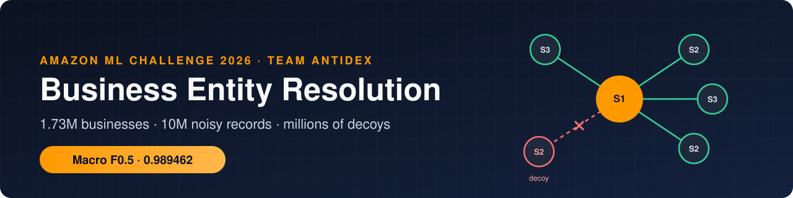
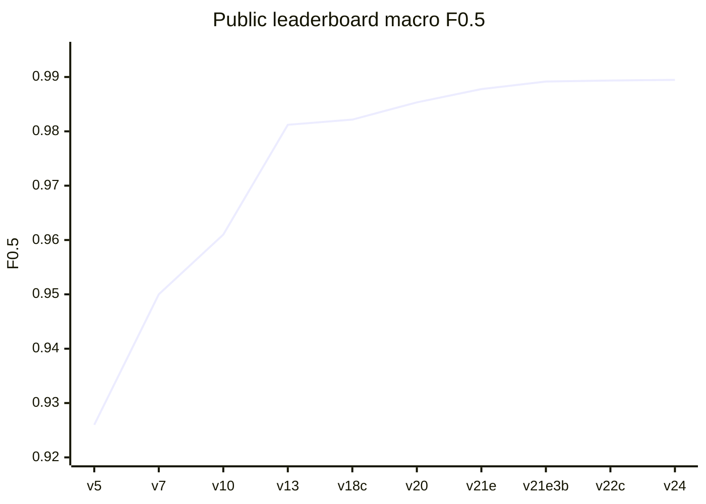
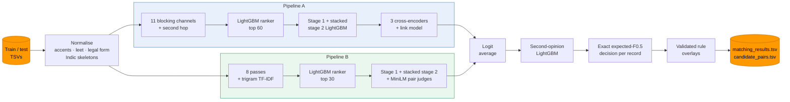

<div align="center">



<br/>

[](#-results)
[](requirements.txt)
[](docs/adr/0003-gradient-boosting-as-core-matcher.md)
[](docs/adr/0007-cross-encoders-on-uncertain-band.md)
[](#-getting-started)
[](LICENSE)

**Two independent entity-resolution pipelines, a learned ensemble and an exact expected-F0.5 decision, built in three days on consumer laptops.**

[Results](#-results) · [How it works](#-how-it-works) · [Key insights](#-key-insights) · [Decisions](#-architecture-decisions) · [Getting started](#-getting-started) · [Full report](docs/methodology.md)

</div>

---

## 📌 At a glance

<table>
<tr>
<td width="25%" align="center"><h3>0.989462</h3>public leaderboard<br/>macro F0.5</td>
<td width="25%" align="center"><h3>0.9918</h3>held-out sealed fold<br/>(US + India, test-like)</td>
<td width="25%" align="center"><h3>122.6M</h3>candidate pairs<br/>scored on test</td>
<td width="25%" align="center"><h3>0.926 → 0.989</h3>leaderboard climb<br/>over 3 days</td>
</tr>
</table>

## 🧩 The problem

For each of **1.73 million** business records in Source 1, find every record in Sources 2 and 3 (about **10 million** records) that describes the same real business. The answer can be none, one or many. Each Source-1 record is scored with **F0.5**, which weighs precision twice as much as recall, and the leaderboard averages it over all records.

It is harder than it sounds:

| Challenge | Why it hurts |
|---|---|
| 🇫🇷 **A country with no labels** | Training covers the US and India. The test set adds France, about 15% of records, with its own naming and address conventions. |
| 🎭 **Adversarial decoys** | 41–48% of test target records belong to no business, against 26% in training. Many copy a real business and change exactly one detail. |
| ✍️ **Heavy noise on true copies** | Typos and leet (`L0TUS`), website names (`wilfordhancock.com`), acronyms (`PMC`), nine Indian scripts, blank or truncated addresses, invented trade names. |
| 👯 **Repeated names** | 38% of records share their name with another record. "Bordeaux Club SARL" appears 205 times. |

The key observation behind the whole system:

> **True copies are messy but faithful. Decoys are clean but wrong in one specific way.**

| ✅ A true copy carries *noise* | ❌ A decoy makes *one meaningful change* |
|---|---|
| `Lotus Traders Pvt Ltd` → `L0TUS TRADERS` | `Lotus Traders Pvt Ltd` → `Lotus Traders Public Ltd` |
| house number `9914` → `914` (truncated) | house number `315` → `325` (one digit replaced) |
| `Wilford Hancock LLC` → `wilfordhancock.com` | `Judo Club` → `Judo Maison` (common word swapped in) |

<sub>Examples are illustrative, modelled on patterns measured in the training data.</sub>

## 📈 Results

| System | Sealed fold (US + India) |
|---|:---:|
| Pipeline A alone | 0.9890 |
| Pipeline B alone | 0.9884 |
| Two-pipeline logit average | 0.9903 |
| **+ retrieval fix + second-opinion correction** (test-like) | **0.9918** |

**Public leaderboard, upload by upload.** Every step was validated on held-out data before an upload was spent on it.



<details>
<summary><b>What each version changed</b></summary>

| Version | Main change | Public LB |
|---|---|:---:|
| v5 | stacked stage 2, Indic consonant skeletons | 0.926 |
| v7 | decoy-aware list features | 0.950 |
| v10 | ranker similarity features | 0.961 |
| v13 | name-word × address-word blocking, decoy features in stage 1 | 0.9812 |
| v18c | TF-IDF search, MiniLM pair judges, test-like training | 0.98216 |
| v20 | pipeline A with three cross-encoders | 0.985328 |
| v21e | two-pipeline average + first France rules | 0.987776 |
| v21e3bx_fr2 | second opinion, US correction, domain and legal-tie rules | 0.989165 |
| v22c | acronyms, formatting-based tie resolution, extra decoy offsets | 0.989359 |
| **v24 (final)** | guarded France ensemble, brand names, domain rule, singleton guard | **0.989462** |

</details>

## ⚙️ How it works



<details>
<summary><b>1 · Normalisation</b>: make noisy records comparable</summary>

- Folds accents, corrects leet (`0→o`, `1→l`), strips junk prefixes and bracketed noise.
- Keeps the **legal form** as its own field instead of deleting it, because a legal-form swap is a decoy signal.
- Maps street abbreviations (Rd/Road, R/Rue, Av/Avenue) and parses house numbers, including truncation and zero-padding.
- Transliterates **nine Indian scripts** and reduces names to consonant skeletons, so a Hindi or Tamil spelling can meet its English original.

`src/normalize.py`
</details>

<details>
<summary><b>2 · Blocking and ranking</b>: find the right 30–60 candidates out of millions</summary>

- Every channel targets a measured failure mode: exact name, rare name words and word pairs, house number + street, rare address words, typo keys, website 4-grams, concatenated-name prefixes, Indic skeletons, digit-dropped house numbers, name word × address word, and character-trigram TF-IDF search on the GPU.
- Frequency caps keep common words ("center" appears 293k times) from creating mega-blocks.
- A cross-fitted **LightGBM ranker** on blocking-graph features cuts about 400 raw candidates per record to the best 30–60.
- **Result:** 98.9% of true pairs survive the cut. A perfect matcher on these candidates would score 0.9965.

`src/ranker.py` · `src/blocking.py` · `src/pipeline_b_v18/src/fuzzy*.py` · [ADR 0001](docs/adr/0001-blocking-then-learned-ranking.md)
</details>

<details>
<summary><b>3 · Matching</b>: pairwise features, then the whole list</summary>

- **Stage 1:** LightGBM on name, address and decoy-relation features, with isotonic calibration.
- **Stage 2 (stacked)** reads each record's **entire candidate list**:
  - consensus on house number, name and legal form with the other candidates;
  - competition from other records claiming the same target;
  - how common the changed words are. A typo creates a rare word; a decoy swaps in a common one.
- Adding the list-context decoy features alone moved the sealed fold from **0.9431 to 0.9666**.

`src/matcher_b.py` · `src/stack.py` · [ADR 0004](docs/adr/0004-list-context-stacking.md)
</details>

<details>
<summary><b>4 · Transformers</b>: only where they pay off</summary>

- **Pipeline A:** three fine-tuned cross-encoders (2× multilingual MiniLM-L12, 1× multilingual-e5-base) re-score only the **uncertain band**, combined through a small LightGBM link model.
- **Pipeline B:** two MiniLM pair judges enter the stacked stage as features.
- Fine-tuned only on the provided pairs. All models are ≤ 278M parameters, under MIT or Apache-2.0 licences.

`src/xenc_cli.py` · `src/xlink.py` · `src/pipeline_b_v18/src/pair_judge*.py` · [ADR 0007](docs/adr/0007-cross-encoders-on-uncertain-band.md)
</details>

<details>
<summary><b>5 · Ensemble and second opinion</b>: two views, one calibrated answer</summary>

- The two pipelines are averaged in **log-odds** space; any weight from 0.3 to 0.7 scores the same within ±0.00005.
- A small **second-opinion LightGBM**, trained out of fold, corrects the average using both pipelines' views, list context, the transformer scores and 23 structural conflict signals.
- Gain: +0.0013 from the average, then +0.0007–0.0009 from the correction.

`src/ensemble/` · [ADR 0008](docs/adr/0008-two-pipelines-and-second-opinion.md)
</details>

<details>
<summary><b>6 · Decision</b>: the exact expected-F0.5 list, including "no match"</summary>

1. Single-owner renormalisation: every target belongs to exactly one record.
2. Validated odds shifts: ×3 for blank-address and website targets, ×0.5 for same-street pairs with a different house number.
3. For each record, choose the candidate subset, **including the empty set**, that maximises the **exact expected F0.5** (Poisson-binomial, O(n²) per record).

`src/decide.py` · [ADR 0005](docs/adr/0005-exact-expected-f05-decision.md)
</details>

<details>
<summary><b>7 · France and final rules</b>: reasoning without labels</summary>

Each rule had to pass label-free checks: the same pattern's accuracy in the labelled countries, class-volume consistency, the blank-address test, and agreement with the model's own confident decisions.

| Rule | Pairs | Evidence |
|---|:---:|---|
| Accent-deleting website names (`mrignacclub` = Mérignac Club) | +1,413 | 99.99% correct on the same rule in training |
| Acronyms at the owner's address | +2,153 | 99.8–99.9% in training; 99.87% agreement with the model |
| Ties resolved by legal form and inherited formatting | +2,839 | 90–100% |
| Invented brand names at the owner's full address | +2,125 | 98.3–98.6% in training |
| US digit-substitution over-acceptance removed | −1,602 | test rate exceeded the true rate |

`src/france/` · `src/final_rules/` · [ADR 0009](docs/adr/0009-label-free-validation-for-france.md) · [ADR 0010](docs/adr/0010-rules-as-explicit-change-lists.md)
</details>

## 💡 Key insights

1. **Make training look like test.** Hiding a share of training records turned their copies into ownerless decoys, matching the test's decoy density. Held-out gains then transferred to the leaderboard almost one for one: +0.0236 held out against +0.024 on the leaderboard.
2. **Context beats similarity.** A decoy is often *more* similar to its target than a noisy true copy is. It only stands out against the record's other candidates.
3. **Decide exactly, not by threshold.** Under F0.5, the empty list is often the best bet. About 70% of singletons have a target with an identical name.
4. **Diversity over size.** Two independently built pipelines added +0.0024 on the leaderboard. A larger cross-encoder (xlm-roberta-base) added nothing.
5. **No labels is not no evidence.** For France, the same generator operation in the labelled countries, plus class-volume and blank-address checks, separated real patterns from wishful ones.

<details>
<summary><b>🧪 What we tried that did not work</b></summary>

| Experiment | Finding |
|---|---|
| More candidates (60 → 100) | Recall plateaus after 40; at most +0.00005 |
| Dense embedding retrieval (multilingual e5) | Recovered few extra matches |
| Larger cross-encoders (xlm-roberta-base) | Lowered the held-out score at every blend weight |
| Moving France's decision threshold | Looser −0.002 on the leaderboard; tighter: no change |
| Plain averaging in France | Would have dropped about 6,500 true copies |
| Breaking US/India same-name ties | At most 65% correct, below the ~77% that F0.5 requires |
| A third stacking level | Same validation loss as stage 2 |

</details>

## 🏛️ Architecture decisions

Every major choice is documented as an [ADR](docs/adr/README.md): the context, the decision, the alternatives we rejected and the evidence.

| # | Decision |
|:---:|---|
| [0001](docs/adr/0001-blocking-then-learned-ranking.md) | Multi-channel blocking plus a learned ranker, not all-pairs or embedding-only retrieval |
| [0002](docs/adr/0002-hard-country-partition.md) | Partition everything by country, with country as an open set |
| [0003](docs/adr/0003-gradient-boosting-as-core-matcher.md) | Gradient-boosted trees as the core matcher; no generative LLMs |
| [0004](docs/adr/0004-list-context-stacking.md) | A stacked stage that reads each record's whole candidate list |
| [0005](docs/adr/0005-exact-expected-f05-decision.md) | Exact expected-F0.5 decision instead of a fixed threshold |
| [0006](docs/adr/0006-test-like-validation.md) | Grouped cross-fitting, a sealed fold and decoy injection |
| [0007](docs/adr/0007-cross-encoders-on-uncertain-band.md) | Small cross-encoders only on the uncertain band |
| [0008](docs/adr/0008-two-pipelines-and-second-opinion.md) | Two independent pipelines, a logit average and a learned correction |
| [0009](docs/adr/0009-label-free-validation-for-france.md) | France: rules validated without labels |
| [0010](docs/adr/0010-rules-as-explicit-change-lists.md) | Final rules shipped as explicit, auditable change lists |

## 🚀 Getting started

> [!NOTE]
> The challenge dataset is not included; it belongs to the organisers. You need the provided `dataset/` folder with `train/` and `test/`.

**1. Install**

```bash
python -m venv .venv && source .venv/bin/activate
pip install -r requirements.txt
```

The transformer stages need a second environment with a CUDA GPU:

```bash
pip install -r requirements_transformer.txt
```

**2. Run everything with one command**

```bash
BER_DATA_DIR=/path/to/dataset PY=python PY_TORCH=/path/to/torch/python bash run_all.sh
```

It runs both pipelines, the ensemble and the final rules, and writes `output/matching_results.tsv` and `output/candidate_pairs.tsv`. Finished stages are marked, so rerunning resumes after an interruption.

| Requirement | Used |
|---|---|
| GPU | one 8–12 GB card |
| RAM | 32 GB |
| Time | about 15–20 hours end to end, mostly transformer stages |

**3. Run the tests**

```bash
python -m pytest tests src/pipeline_b_v18/tests
```

See the [reproduction guide](docs/reproduction.md) for the stage-by-stage commands.

## 📁 Repository layout

```text
.
├── run_all.sh                    one-command reproduction (data → output/)
├── reproduce.sh                  pipeline A from scratch
├── requirements.txt              pinned CPU environment (Python 3.12)
├── requirements_transformer.txt  pinned PyTorch + transformers environment
├── src/                          pipeline A: normalise, block, rank, match, stack, decide, transformers
│   ├── pipeline_b_v18/           pipeline B, self-contained with its own tests
│   ├── ensemble/                 logit average and second-opinion model
│   ├── france/                   France decision rules
│   └── final_rules/              rule overlays, change lists, and the evidence for each rule
├── scripts_pipeline_a/           version-by-version run scripts for pipeline A
├── tests/                        scorer, decision, normalisation and stacking tests
└── docs/
    ├── methodology.md            full technical report
    ├── summary.md                two-page summary
    ├── reproduction.md           step-by-step reproduction guide
    ├── pipeline_a.md             pipeline A stage reference
    └── adr/                      architecture decision records
```

## ✅ Compliance

- Trained only on the provided training data; no external data, APIs, geocoders or gazetteers.
- Models: LightGBM (MIT), paraphrase-multilingual-MiniLM-L12-v2 (Apache-2.0, 118M), multilingual-e5-base (MIT, 278M), all far below the 8B-parameter limit.
- No generative model produces output; every predicted ID comes from a retrieved candidate.
- The official validator passes on the final files with `--check-ids`.

## 👥 Team Antidex

<table>
<tr>
<td align="center" width="25%"><b>Tanmay Rawal</b></td>
<td align="center" width="25%"><b>Shiviansh Yadav</b></td>
<td align="center" width="25%"><b>Mudit Todi</b></td>
<td align="center" width="25%"><b>Yash Jain</b></td>
</tr>
</table>

## 🙏 Acknowledgements

Thanks to the Amazon ML Challenge 2026 organisers for a carefully designed problem. Its synthetic decoys made this one of the most interesting entity-resolution tasks we have worked on.

## 📄 License

The code is released under the [MIT License](LICENSE). The challenge dataset is not part of this repository and remains subject to the organisers' terms.
