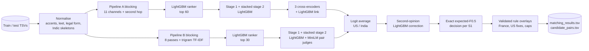

# Business Entity Resolution at Scale

**Team Antidex** — Amazon ML Challenge 2026 · public leaderboard **0.989462** macro F0.5

Tanmay Rawal · Shiviansh Yadav · Mudit Todi · Yash Jain

---

For every business record in Source 1 (1.73M test records), find all records in Sources 2 and 3 (about 10M records) that describe the same real business. The answer can be none, one or many. Each Source-1 record is scored with F0.5, which weighs precision twice as much as recall, and the score is the mean over all records.

Two things make this harder than a textbook matching task:

- **A new country with no labels.** Training covers the US and India; the test set adds France.
- **Adversarial decoys.** About 41–48% of test target records belong to no business, against 26% in training. Many copy a real business and change one detail, such as the legal form or a house-number digit.

## Results

| System | Score |
|---|---|
| Pipeline A alone (sealed fold, US + India) | 0.9890 |
| Pipeline B alone (sealed fold, US + India) | 0.9884 |
| Two-pipeline ensemble + second opinion (sealed fold, test-like) | **0.9918** |
| Final submission, public leaderboard (all countries) | **0.989462** |

The public score rose from 0.926 to 0.989462 over the three-day challenge. The upload history is in [docs/methodology.md](docs/methodology.md#5-results--error-analysis).

## Architecture



| Stage | What it does | Where |
|---|---|---|
| Normalisation | Folds accents, fixes leet, separates the legal form, parses house numbers, transliterates nine Indian scripts into consonant skeletons | `src/normalize.py` |
| Blocking | Retrieves candidates within each country through complementary keys; every key targets a measured failure mode | `src/ranker.py`, `src/blocking.py`, `src/pipeline_b_v18/src/fuzzy*.py` |
| Ranking | LightGBM on blocking-graph and similarity features keeps the best 30–60 candidates per record | `src/ranker.py` |
| Matching | Calibrated stage-1 LightGBM, then a stacked stage 2 that reads the whole candidate list: consensus, competition, decoy and vocabulary features | `src/matcher_b.py`, `src/stack.py` |
| Transformers | Fine-tuned multilingual cross-encoders (MiniLM, e5-base; ≤ 278M parameters) re-score uncertain pairs | `src/xenc_cli.py`, `src/xlink.py`, `src/pipeline_b_v18/src/pair_judge*.py` |
| Ensemble | Logit-average of both pipelines, then a LightGBM "second opinion" trained out of fold | `src/ensemble/` |
| Decision | Chooses each list, including the empty list, by exact expected F0.5 | `src/decide.py` |
| Rules | France rules and final corrections, each validated before use and shipped as explicit pair lists | `src/france/`, `src/final_rules/` |

## Architecture decisions

Every major design choice is written up as an [architecture decision record](docs/adr/README.md), with the alternatives we considered and the evidence behind the choice.

| ADR | Decision |
|---|---|
| [0001](docs/adr/0001-blocking-then-learned-ranking.md) | Multi-channel blocking plus a learned ranker, not all-pairs or embedding-only retrieval |
| [0002](docs/adr/0002-hard-country-partition.md) | Partition everything by country, with country as an open set |
| [0003](docs/adr/0003-gradient-boosting-as-core-matcher.md) | Gradient-boosted trees as the core matcher; no generative LLMs |
| [0004](docs/adr/0004-list-context-stacking.md) | A stacked second stage that reads each record's whole candidate list |
| [0005](docs/adr/0005-exact-expected-f05-decision.md) | Exact expected-F0.5 decision instead of a fixed threshold |
| [0006](docs/adr/0006-test-like-validation.md) | Grouped cross-fitting, a sealed fold and decoy injection |
| [0007](docs/adr/0007-cross-encoders-on-uncertain-band.md) | Small cross-encoders only on the uncertain band |
| [0008](docs/adr/0008-two-pipelines-and-second-opinion.md) | Two independent pipelines, a logit average and a learned correction |
| [0009](docs/adr/0009-label-free-validation-for-france.md) | France: rules validated without labels |
| [0010](docs/adr/0010-rules-as-explicit-change-lists.md) | Final rules shipped as explicit, auditable change lists |

## Repository layout

```
├── run_all.sh                    one-command reproduction (data → output/)
├── reproduce.sh                  pipeline A from scratch
├── requirements.txt              pinned CPU environment (Python 3.12)
├── requirements_transformer.txt  pinned PyTorch + transformers environment (CUDA)
├── src/                          pipeline A (normalise, block, rank, match, stack, decide, transformers)
│   ├── pipeline_b_v18/           pipeline B, self-contained with its own tests
│   ├── ensemble/                 two-pipeline average and second-opinion model
│   ├── france/                   France decision rules
│   └── final_rules/              final rule overlays, change lists and the evidence for each rule
├── scripts_pipeline_a/           version-by-version run scripts for pipeline A
├── tests/                        unit tests (scorer, decision, normalisation, stacking)
└── docs/
    ├── methodology.md            full technical report
    ├── summary.md                two-page summary
    ├── reproduction.md           step-by-step reproduction guide
    ├── pipeline_a.md             pipeline A stage reference
    └── adr/                      architecture decision records
```

## Running it

The competition data is not included; it belongs to the organisers. Put the provided `dataset/` folder (with `train/` and `test/`) somewhere local.

```bash
python -m venv .venv && . .venv/bin/activate
pip install -r requirements.txt
# for the transformer stages, a second environment with a CUDA GPU:
pip install -r requirements_transformer.txt
```

```bash
BER_DATA_DIR=/path/to/dataset PY=python PY_TORCH=/path/to/torch/python bash run_all.sh
```

`run_all.sh` runs both pipelines, the ensemble and the final rules, and writes `output/matching_results.tsv` and `output/candidate_pairs.tsv`. Finished stages are marked, so rerunning the command resumes after an interruption. Expect roughly 15–20 hours on one 8–12 GB GPU with 32 GB RAM. See [docs/reproduction.md](docs/reproduction.md) for the step-by-step version.

To run the tests:

```bash
python -m pytest tests src/pipeline_b_v18/tests
```

The analysis scripts in `src/final_rules/scripts/` and `src/france/fr2_rules/` document how each rule was derived and validated. They read from a local `work/` folder set in constants at the top of each file, and they are not part of the one-command run.

## Compliance

- Trained only on the provided training data. No external data, APIs, geocoders or gazetteers.
- Models: LightGBM (MIT); paraphrase-multilingual-MiniLM-L12-v2 (Apache-2.0, 118M); multilingual-e5-base (MIT, 278M). All are far below the 8B-parameter limit.
- No generative model produces any output; every predicted ID comes from a retrieved candidate.

## Licence

Code is released under the [MIT licence](LICENSE). The challenge dataset is not part of this repository and is subject to the organisers' terms.
